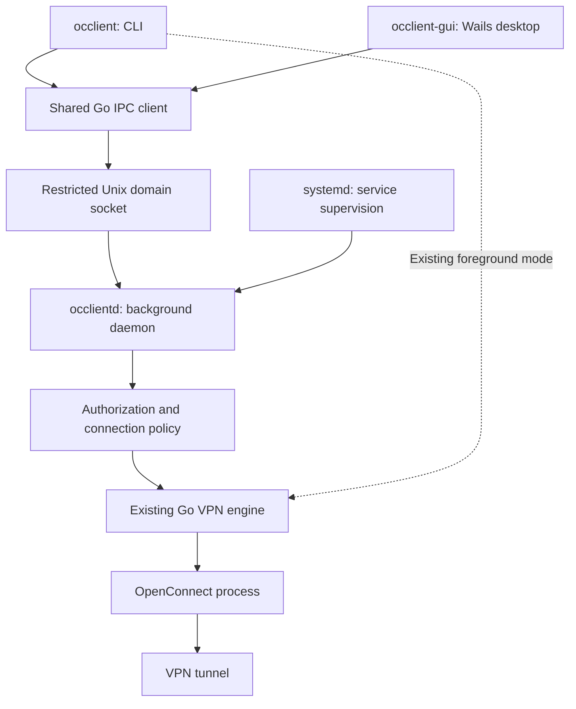
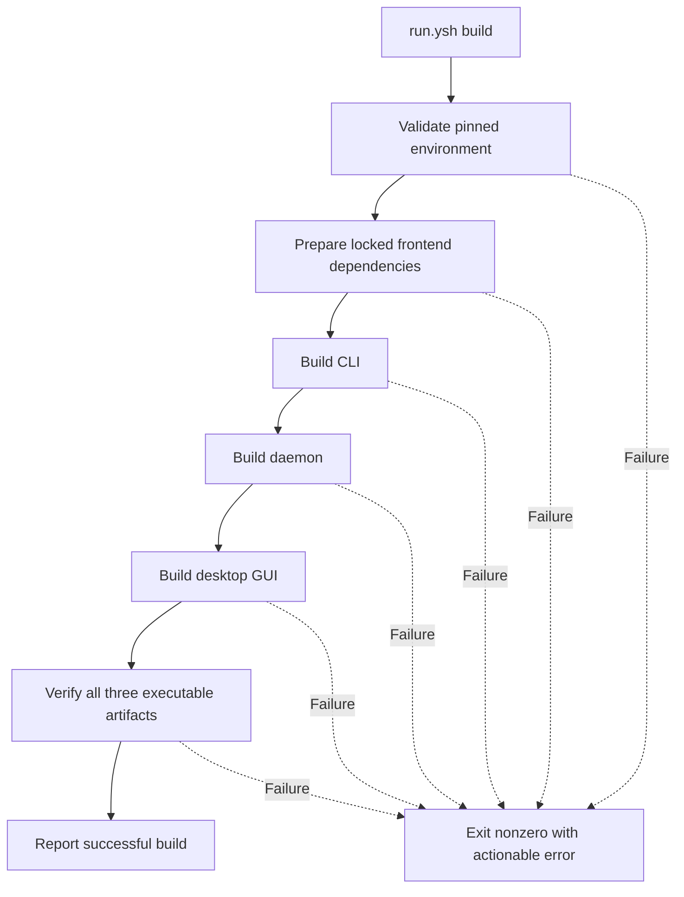
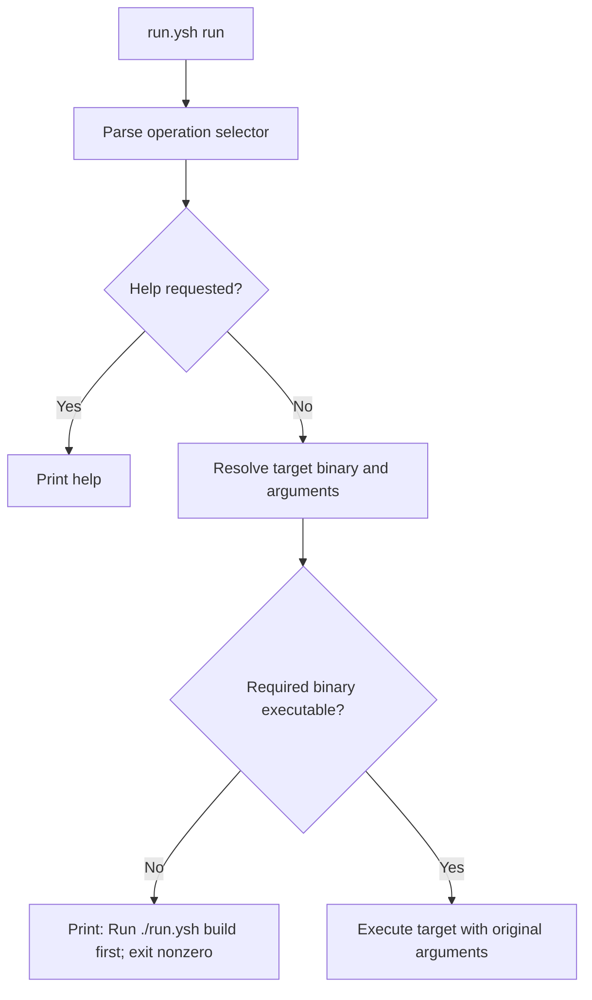
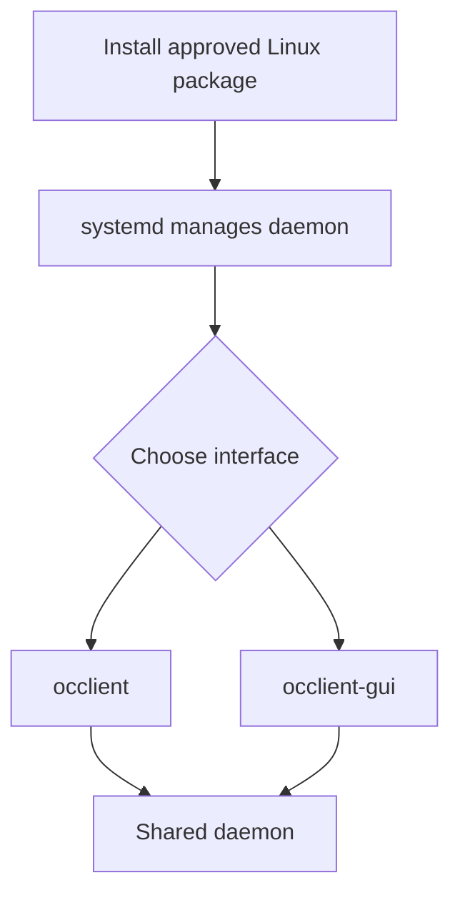

# Phase 5 — Desktop UI Foundation & Unified Developer Workflow

**Project:** OpenConnect Client  
**Branch:** `feat/desktop-ui-foundation`  
**Prerequisite:** Phase 4 merged, CI passing, branch protection restored.  
**Status:** Proposed implementation plan

## 1. Objective

Establish a native Linux desktop application alongside the existing CLI and daemon. Provide one project-local build command and one unified runtime command. Preserve the existing VPN engine, foreground CLI behavior, restricted Unix socket IPC, connection policy, and unified test runner.

SAML/SSO authentication is deferred to Phase 6. This phase is a foundation, not a production-ready VPN GUI.

## 2. Long-term architecture



| Component | Responsibility | Audience |
|---|---|---|
| `occlient` | Terminal interface and automation | Developers, administrators, headless users |
| `occlient-gui` | Desktop interface | Everyday users and corporate employees |
| `occlientd` | Shared background connection lifecycle | Managed service |
| OpenConnect | Actual VPN tunnel | Internal dependency |
| systemd | Daemon supervision | Linux service manager |

### Why maintain both interfaces?

- Reach desktop users and terminal-oriented users without maintaining two VPN engines.
- Enable headless operation, scripting and enterprise integration where authentication policy permits.
- Keep privileged networking outside the GUI and normal CLI process.
- Allow users to close the GUI without terminating daemon-owned connections.
- Share connection state between interfaces and isolate UI failures from VPN lifecycle management.
- Enable future system tray, SDK and enterprise management integrations.

Trade-offs include native GUI dependencies, additional CI coverage and packaging complexity. The shared backend limits duplication but does not eliminate integration work.

## 3. Technology stack and compatibility gate

| Layer | Proposed technology |
|---|---|
| Backend | Go toolchain selected by `go.mod`, existing IPC client |
| Desktop | Wails v3.0.0 |
| Frontend | React, TypeScript |
| Styling | Tailwind CSS |
| Development server | Vite |
| Frontend runtime | Node.js and npm from the pinned Guix channel |
| Environment | Guix, pinned channels and manifest |
| Task runner | YSH (`run.ysh`) |
| Service | Existing experimental systemd unit |

### Task 5.1 compatibility audit

The pinned Guix channel is `4790fe167d5e14c819df60938040fefcc1b37f98`. At
that revision, the unversioned manifest package names resolve to Go 1.27.3,
Node.js 26.12.1, GCC toolchain 16.2.0, pkg-config 0.29.2, GTK 4.22.1,
WebKitGTK 2.50.3 and xz 5.4.5. The WebKitGTK package depends on GTK 4.22.1;
xz supplies `liblzma.pc`, required by WebKitGTK's pkg-config dependency chain.
Keep package names unversioned in the manifest; the pinned channel supplies
reproducible package versions. `go.mod` declares the Go language minimum as
1.26.3 and selects the Go 1.27.3 toolchain with its `toolchain` directive.

Wails v3 is the selected target. Its [Linux installation requirements](https://v3.wails.io/getting-started/installation/)
specify Go 1.26 or later and GTK 4 with WebKitGTK 6.0. The pinned channel has
candidate packages for these native dependencies. The pinned project
environment was verified to provide Go 1.27.3, Node.js 26.12.1, npm 11.20.0,
GTK 4.22.1 and WebKitGTK 6.0 (2.50.3); `pkg-config` resolves both `gtk4` and
`webkitgtk-6.0`. Recheck these requirements after changing the channel or
manifest, and stop before scaffolding if compatibility no longer holds.

The audit confirms that the GUI adapter can reuse `internal/ipc.Client` and the
existing versioned connect, status and disconnect contract. The daemon's
administrator policy may deny connection requests. Although the IPC contract
includes `connected`, the current VPN engine reports process start as
`connecting` and does not confirm tunnel readiness; the UI must not imply
otherwise. Authentication remains deferred.

The current YSH build task builds only the CLI and daemon, and its run task
builds the CLI when its binary is missing. CI currently invokes Go commands
directly and does not run the unified test runner checks. Changes to build/run
semantics and CI remain in their later Phase 5 tasks.

Use project-local tools or Guix-provided tools; do not install global npm or Go.
The Guix-provided Node package supplies npm; run `npm ci` from the frontend
directory to install only the lockfile-pinned project dependencies locally.
Commit frontend lockfiles so npm dependencies are pinned independently of the
Guix package channel. Document any
unavoidable host runtime prerequisites. Do not silently bypass Guix or change
the pinned environment without approval. If native GUI compilation cannot be
supported reproducibly, stop and propose alternatives.

## 4. Desktop UI foundation


### Proposed screen layout

```text
+------------------------------------------------------------+
| OpenConnect Client                              -  []  x  |
+----------------+-------------------------------------------+
| VPN            | VPN Connection                            |
| Profiles       |                                           |
| Logs           |          [ Shield icon ]                  |
| Settings       |          Disconnected                     |
|                |                                           |
|                | Server   [ vpn.example.com           ]    |
|                | Protocol [ AnyConnect                v]   |
|                |                                           |
|                |              [ Connect ]                  |
|                |                                           |
| Development    | Daemon: Available                         |
+----------------+-------------------------------------------+
```

- Provide light/dark themes, accessible labels, keyboard navigation, focus states and reusable components.
- Display daemon availability separately from VPN state; unavailable is not equivalent to disconnected.
- Represent connecting, connected, disconnecting, disconnected and error states according to the existing IPC contract.
- Expose only supported connection fields and actions. Disable unsupported authentication flows with clear explanations.
- Profiles, Logs and Settings may be clearly labeled placeholders; do not invent data or expose raw sensitive logs.
- Use bounded IPC calls, cancellation and status refresh; avoid blocking the UI thread. Prevent duplicate actions while requests are pending.
- Never launch shell commands from the frontend or expose arbitrary command execution through Wails bindings.

### Shared connection lifecycle

```mermaid
sequenceDiagram
    participant G as Desktop GUI
    participant D as occlientd
    participant O as OpenConnect
    participant C as CLI
    G->>D: Connect via authorized IPC
    D->>O: Start supported VPN connection
    O-->>D: Lifecycle result
    D-->>G: Connection state
    Note over G,D: GUI closes; daemon-owned connection remains
    C->>D: Status request
    D-->>C: Current state
    C->>D: Disconnect request
    D->>O: Graceful stop
    D-->>C: Updated state
```

This sequence is a target for supported authentication modes, not a claim that SAML or every VPN server works today. Closing the GUI must not stop the daemon or its tunnel.

## 5. Unified build workflow

```bash
./scripts/shell.sh
./run.ysh build
```

The build task prepares project-local frontend dependencies using the committed lockfile (for example `npm ci` where appropriate), then builds all three components. It must not install system packages, copy binaries into system directories, enable services or request sudo.



Proposed output (verify existing conventions first):

```text
build/
├── occlient
├── occlientd
└── occlient-gui
```

Centralize artifact paths. Avoid reporting success for partial builds; prefer staging outputs before publishing them and ensure failed builds cannot be mistaken for a fresh successful build. Document rebuild requirements after source changes or branch switches. Consider a build freshness warning without introducing automatic compilation.

## 6. Unified run command

| Command | Behavior |
|---|---|
| `./run.ysh run` | Launch compiled GUI (default) |
| `./run.ysh run --gui` | Explicit GUI launch |
| `./run.ysh run -c` / `--connect` | Invoke CLI connect |
| `./run.ysh run -d` / `--disconnect` | Invoke CLI disconnect |
| `./run.ysh run -s` / `--status` | Invoke CLI status |
| `./run.ysh run --daemon` | Launch compiled development daemon |
| `./run.ysh run -v` / `--version` | Display CLI version |
| `./run.ysh run -h` / `--help` | Show help without requiring a build |
| `./run.ysh dev` | Wails/Vite development mode with hot reload |
| `./run.ysh test` | Existing unified test runner |
| `./run.ysh clean` | Remove project-generated artifacts only, if approved |

Preserve existing task names and semantics where possible. Inspect existing options before implementing aliases. Select at most one operation; forward operation-specific arguments exactly, including quoted values and flags. Define a clear parsing boundary (operation selector first, remaining arguments forwarded; document `--` behavior). Reject conflicting selectors and unknown wrapper options without swallowing valid CLI options. Preserve exit codes, streams and signals; prefer process replacement where supported by YSH. Do not use eval or construct shell command strings.

```bash
./run.ysh run -c --server vpn.example.com --background
./run.ysh run -s
./run.ysh run -d
```

The existing foreground connection mode remains supported. For shared daemon state, use the existing background option unless a separately approved CLI change is made. Verify actual flags against Phase 4 code.



No runtime task automatically builds, elevates privileges, installs services or starts privileged processes. The explicit `dev` task is the exception for compilation and hot reload, not for privilege elevation. A development daemon may require separate documented setup and authorized permissions; do not weaken production IPC policy for convenience.

On the pinned Guix environment, WebKitGTK's Bubblewrap startup fails if
`GUIX_LOCPATH` includes the profile's symlinked locale directory. The GUI
smoke test succeeds when that variable contains the canonical Guix locale
store path. Handle this in the unified launch workflow without disabling the
WebKit sandbox.

## 7. Contributor workflows

### Compiled application

```bash
./scripts/shell.sh
./run.ysh build
./run.ysh run
```

### Background connection testing

In a separate terminal, enter the development environment and launch the daemon using its documented safe development configuration:

```bash
./run.ysh run --daemon
```

Then use the GUI or CLI background operations from another terminal. If real VPN networking requires privileges, follow the existing explicit service setup documentation; never run the GUI as root.

### GUI development

```bash
./scripts/shell.sh
./run.ysh dev
```

### End-user workflow (future packaging)



Production installation, service activation and packaging are deferred. The current experimental unit must not be silently installed by the build task.

## 8. Proposed repository structure

```text
.
├── cmd/
│   ├── occlient/        # Existing CLI
│   ├── occlientd/       # Existing daemon
│   └── occlient-gui/    # Wails desktop application entry point
├── internal/
│   ├── app/             # Existing CLI application layer
│   ├── daemon/          # Existing daemon lifecycle and policy
│   ├── gui/             # Embedded assets and frontend source
│   │   ├── frontend/    # React, TypeScript, Vite, Tailwind, lockfile
│   │   └── web/         # Generated embedded frontend output
│   ├── ipc/             # Existing Unix socket protocol and transport
│   └── vpn/             # Existing VPN engine
├── build/               # Generated artifacts; ignored by Git
├── scripts/             # Existing environment setup
├── docs/plans/
│   └── phase-5-desktop-ui-foundation.md
├── run.ysh
├── README.md
└── CONTRIBUTING.md
```

Keep the desktop entry point under `cmd/` and its Wails assets and frontend
under `internal/gui/`, following the existing command and internal-package
conventions. Reuse the root Go module and avoid duplicated IPC clients.

## 9. Implementation tasks

| Task | Deliverable | Acceptance gate |
|---|---|---|
| 5.1 (complete) | Repository audit, architecture and dependency compatibility | Approved architecture and pinned toolchain; npm and GTK/WebKitGTK pkg-config modules verified |
| 5.2 (complete) | Wails scaffold and frontend foundation | Wails window launches; locked frontend builds reproducibly |
| 5.3 (complete) | Shared Go IPC adapter and typed bindings | Fake daemon tests; bounded requests; no privileged UI |
| 5.4 (complete) | VPN screen, navigation, themes and state handling | Accessible UI; honest status; supported actions only |
| 5.5 (complete) | Unified build for all three binaries | Clean project-local build; clear failure behavior |
| 5.6 (complete) | Unified run command and help | Dispatch, argument forwarding, missing binary and signal tests |
| 5.7 (complete) | Development mode and environment integration | Hot reload works without global tool installs |
| 5.8 | Testing, CI and security regression coverage | Existing tests preserved; new tests and builds pass |
| 5.9 | Documentation and manual verification | Contributor workflow documented and reviewed |

Work on exactly one task at a time. Propose affected files, implementation and tests, then wait for approval. After implementation, report actual commands, results and limitations and wait again.

## 10. Security boundaries

- Preserve daemon authorization, restricted socket permissions, connection policy and server validation.
- Do not allow arbitrary executable paths, scripts, shell strings or privileged configuration through GUI bindings.
- Keep GUI and normal CLI unprivileged; do not auto-sudo or make sockets world-writable.
- Do not store credentials or tokens in frontend storage, logs, command-line arguments or test fixtures.
- Use trusted local frontend assets; restrict navigation and external content according to Wails capabilities.
- Validate input on the backend; frontend validation is not a security boundary.
- Do not introduce SAML, credential persistence, automatic reconnect or production service installation in this phase.

## 11. Testing and CI

Preserve Phase 4 unified test commands, race/repeat options, linting, formatting and vulnerability scanning. Verify exact existing commands before editing CI.

- Go: IPC adapter tests using fakes, timeout/cancellation, daemon unavailable, authorization failure, lifecycle and foreground regression.
- Frontend: rendering, state transitions, disabled actions, errors, theme and keyboard accessibility; typecheck and production asset build.
- YSH: default GUI dispatch, every alias, conflicting/unknown selectors, quoted arguments, missing/non-executable binary, exit status, signal forwarding and help without build.
- Build: clean checkout, locked dependency installation, all three binaries, partial failure and artifact verification.
- CI: retain headless backend tests; add frontend and native GUI build jobs with documented pinned dependencies. Use a virtual display only where needed for GUI smoke tests. Do not require real VPN credentials or privileged networking in ordinary CI.
- Manual: launch GUI, observe unavailable daemon, start authorized development daemon, verify supported connection/status/disconnect across interfaces, close/reopen GUI and verify daemon-owned connection persists. If real connection testing is blocked by authentication or privileges, report it explicitly rather than marking it passed.

## 12. Definition of done

- [x] Phase 5 architecture and toolchain decisions approved.
- [ ] All three binaries build through `./run.ysh build` without global installation or sudo.
- [ ] Unified run options and explicit build prerequisite work as documented.
- [ ] GUI launches and reflects actual daemon availability and connection state.
- [ ] Shared IPC client is reused; existing security boundaries and foreground CLI remain intact.
- [ ] Development hot reload works in the documented environment.
- [ ] Existing and new tests, CI, formatting and security checks pass.
- [ ] README, CONTRIBUTING, task help, architecture and security docs updated.
- [ ] Manual verification results and known limitations recorded.
- [ ] No SAML/SSO implementation or production packaging added prematurely.

## 13. Revised roadmap

1. Guix development environment
2. Go project foundation
3. OpenConnect VPN engine
4. Background VPN service
5. Desktop UI foundation and unified developer workflow (this phase)
6. SAML/SSO authentication
7. Connection profiles and credential management
8. Complete desktop UI integration
9. Linux packaging and distribution
10. Production readiness and release

## 14. Copilot kickoff prompt

Read `.github/copilot-instructions.md`, this plan, existing Phase 4 code, Guix manifests, YSH tasks, CI and documentation. Begin Task 5.1 only. Inspect the repository and propose the desktop architecture, pinned dependency compatibility, build/run contract, affected files, tests and blockers. Do not modify files until I approve. Work one task at a time; report test results and wait before continuing. Do not create branches, commit, push or automatically append AI co-author attribution. Do not begin Phase 6.

## 15. Assumptions and open decisions

The plan is based on the reported Phase 4 implementation and prior design discussion, not a fresh inspection of repository source. Exact Wails version, native dependencies, IPC contract, artifact paths, existing task syntax and real VPN authentication support require Task 5.1 verification. GUI is the default `run` target by design; build prepares local dependencies and compiles all components, not system-wide installation. The roadmap renumbering is intentional.
